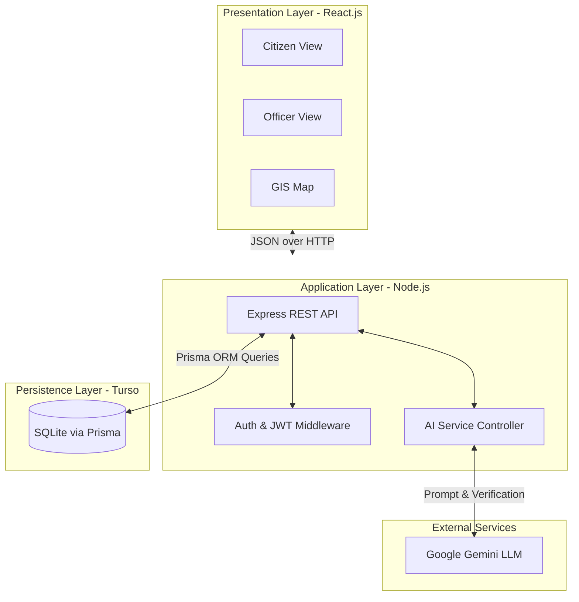
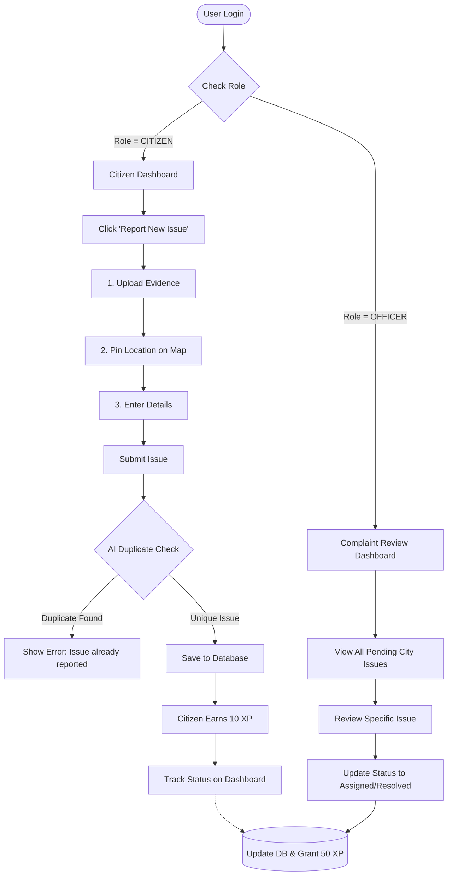

# PROJECT REPORT

**CIVICFIX: SMART ISSUE REPORTING & MANAGEMENT SYSTEM**
*An AI-Powered Digital Platform for Civic Governance and Grievance Redressal*

---

## 1. ABSTRACT
Traditional civic grievance redressal systems suffer from manual tracking, lack of transparency, duplicate complaints, and delayed response times. **CivicFix** is a modern, AI-powered web platform designed to bridge the gap between citizens and municipal authorities. 

The system provides a seamless, gamified experience for citizens to report civic issues (like potholes, water leaks, and waste management) using geolocation and image evidence. For administrators and officers, it provides a centralized dashboard to review, track, and update the status of these complaints. A key innovation of this project is the integration of **AI-based Duplicate Detection**, which uses advanced LLMs to prevent the submission of identical issues in the same vicinity, thereby reducing the administrative burden.

## 2. INTRODUCTION

### 2.1 Problem Statement
Citizens face significant friction when reporting local infrastructure issues due to fragmented communication channels. Furthermore, authorities are often overwhelmed by duplicate complaints for the exact same issue, leading to wasted resources. There is a need for a centralized, intelligent, and transparent system to handle civic grievances efficiently.

### 2.2 Project Objectives
1. **Centralized Platform:** A unified portal for both Citizens and Officers with Role-Based Access Control (RBAC).
2. **AI Duplicate Detection:** Automatically detect and block duplicate complaints within a specific radius using Google Gemini AI.
3. **Location-based Tracking:** Integrate interactive maps (GIS/Leaflet) for pinpointing exact issue locations.
4. **Gamification:** Reward citizens with 'XP' (Experience Points) and badges for actively reporting issues that get resolved.
5. **Modern UI/UX:** Provide a highly responsive, accessible, and premium interface with Dark/Light mode support.

---

## 3. SYSTEM ARCHITECTURE & TECH STACK

The project is built using a modern JavaScript/TypeScript ecosystem, following a 3-tier architecture.

### 3.1 Technology Stack
* **Frontend (Presentation Layer):** React.js (Vite), Tailwind CSS v4, React Router, Lucide React (Icons), Context API (Theme Management).
* **Backend (Application Layer):** Node.js, Express.js, RESTful APIs.
* **Database (Persistence Layer):** SQLite (hosted on Turso), Prisma ORM.
* **AI & External Services:** Google Gemini API (for AI insights and duplicate detection), Leaflet.js (for Maps).

### 3.2 System Architecture
* **Client Side:** Handles dynamic user interfaces, multi-step forms (wizard), and stores JWT tokens for secure sessions.
* **Server Side:** Express server that validates requests, handles business logic (like checking coordinate proximity for duplicates), and communicates with the AI service.
* **Database Side:** Prisma ORM manages relational data ensuring data integrity and fast queries.

---

## 4. CORE MODULES

### 4.1 Authentication & RBAC Module
* **JWT-Based Login/Registration:** Secure authentication using bcrypt password hashing.
* **Role-Based Routing:** 
  * *Citizens* can access their dashboard, report issues, and view their own history.
  * *Officers/Admins* have exclusive access to the "Complaint Review" dashboard to oversee all city-wide issues.

### 4.2 Citizen Dashboard & Gamification
* Displays personalized metrics: Total Reported, Issues Resolved, and Civic Impact Score (XP).
* A progress timeline to track the status of reported issues (Submitted -> Verified -> Assigned -> In Progress -> Resolved).

### 4.3 AI-Powered Issue Reporting Wizard
* A 3-step interactive form:
  1. **Evidence Upload:** Drag-and-drop image upload.
  2. **Location Pinning:** Interactive map to select the exact GPS coordinates.
  3. **Details:** Title, description, and category selection.
* **AI Duplicate Check:** Before saving, the backend fetches unresolved issues within a ~2km radius and uses AI to determine if the new image/description matches an existing open issue.

### 4.4 Officer 'Complaint Review' Dashboard
* A secure table view for admins to see all system-wide issues.
* **Action Controls:** Allows admins to update the status of complaints and assign them to respective departments.
* **City-wide Analytics:** Displays global resolution rates and pending work.

---

## 5. DATABASE DESIGN (SCHEMA OVERVIEW)

The database is structured relationally using Prisma. Core entities include:

1. **User Table:** 
   * `id` (PK), `name`, `email`, `password_hash`, `role` (CITIZEN / OFFICER / DEPT_HEAD), `xp_points`, `created_at`.
2. **Issue Table:**
   * `id` (PK), `title`, `description`, `status`, `latitude`, `longitude`, `address`, `citizen_id` (FK), `category_id` (FK).
3. **Category Table:**
   * `id` (PK), `name` (e.g., Road, Water, Electricity).
4. **Issue Image Table:**
   * `id` (PK), `issue_id` (FK), `image_url`, `image_type` (REPORT / RESOLUTION).

---

## 6. SYSTEM LIMITATIONS & FUTURE SCOPE

### 6.1 Current Limitations
* **In-Memory Proximity Search:** Distance filtering for duplicate detection currently relies on rough coordinate math rather than native PostGIS extensions (due to SQLite limitations).
* **Manual AI Checks:** The AI duplicate detection adds a slight delay to the submission process due to external API calls.

### 6.2 Future Scope
* **Background Job Processing:** Implement Redis and BullMQ to handle AI processing and image optimization asynchronously.
* **Native Mobile Application:** Develop a React Native or Flutter app for easier on-the-go reporting.
* **Real-Time Chat:** Integrate Socket.io for live communication between citizens and assigned field workers.

---

## 7. STRUCTURAL DIAGRAMS & FLOWCHARTS

### 7.1 High-Level System Architecture
The following diagram illustrates the 3-tier architecture and how the components interact with external services like Google Gemini AI.

### 7.2 User Workflow (Citizen & Admin Flow)
This flowchart shows the step-by-step process of how a grievance is reported, verified by AI, and resolved by an Officer.

---

## 8. CONCLUSION
The **CivicFix System** successfully digitizes and modernizes local grievance redressal. By combining a highly intuitive React frontend with a robust Node/Prisma backend and cutting-edge AI for duplicate detection, the platform drastically reduces administrative overhead and encourages active citizen participation in urban maintenance.
